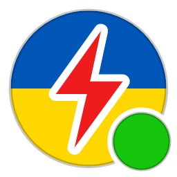

  

  # ⚡ SvitloAlertChecker

  ### 💥 Глобальне об'єднання: AlertChecker + SvitloChecker
  **Повітряна тривога + Графік відключень світла для ПК у єдиному Soft Bento віджеті**

  

    
    
    
  

  

    
    
    
  

---

  
  
  

---

## 🎯 Можливості віджета

| 🚨 Радар тривог & Flash Screen | ⚡ Графіки світла 20+ областей |
| :--- | :--- |
| • Моніторинг по **всіх 136 районах** України • Червоні загрози та **жовта підвищена небезпека** • **3-колірний спалах (Flash Screen)** по краях монітора • Звук сирени та звуковий/голосовий відбій | • Автооновлення розкладу без ботів і сайтів • Підтримка **ДТЕК, YASNO та всіх Обленерго** • Точний вибір підчерги **(1.1–6.2)** • Зворотний таймер до зміни статусу мережі |

| ⏱ Шкала 6 / 24 години над треєм | 🛡 Ігровий Click-Through & Приглушення |
| :--- | :--- |
| • Компактна Soft Bento капсула на найближчі 6 годин • Розгортання в один клік на **добу (24 год) та завтра** • Автооновлення статусу світла щохвилини • Не перекриває важливі елементи робочого столу | • Режим **«Не реагувати на кліки»** (Click-Through) • Курсор проходить крізь віджет — **не збиває приціл у шутерах** • **Розумне приглушення**: плавно тьмяніє, коли світло є і немає тривог |

---

## 📥 Встановлення та запуск

1. Завантажте програму:
   * **[Сторінка на itch.io](https://devmihey.itch.io/svitloalertchecker)** *(швидке завантаження)*
   * **[Останній реліз на GitHub (.exe)](https://github.com/DEVMIHEY/SvitloAlertChecker/releases/latest)**
2. Запустіть файл `SvitloAlertChecker.exe` (встановлення не потрібне, програма портативна).
3. У налаштуваннях оберіть вашу область, район та номер черги.

---

## 🔌 Підтримувані оператори

- **ДТЕК** (Київ, Київська область, Дніпропетровська, Одеська, Донецька обл.)
- **YASNO** (Київ, Дніпро)
- **Всі Обленерго України** (Львів, Харків, Полтава, Вінниця, Миколаїв, Прикарпаття, Запоріжжя, Хмельницький, Чернівці, Черкаси, Житомир, Суми, Чернігів, Волинь, Рівне, Тернопіль, Закарпаття, Кіровоград).

---

  Зроблено з 💛💙 в Україні · Автор: <a href="https://devmihey.itch.io/svitloalertchecker">DEV MIHEY</a> · Офіційний сайт: <a href="https://devmihey.github.io/SvitloAlertChecker/">devmihey.github.io/SvitloAlertChecker</a>

